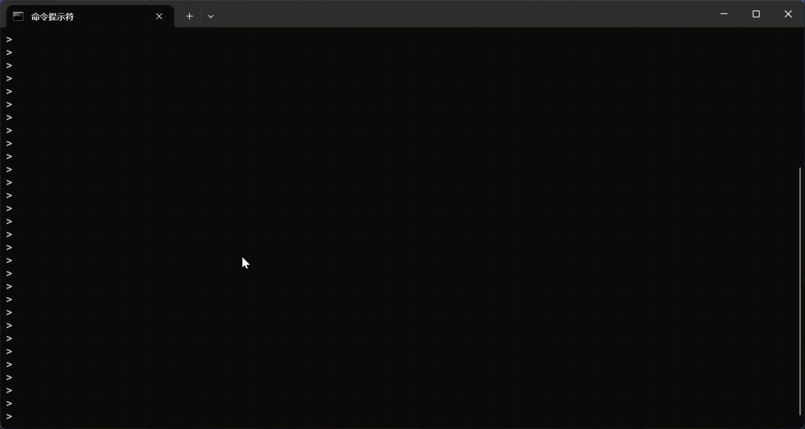

# 豆包 Web 多轮对话复现（纯 Python）

逆向并复现豆包（www.doubao.com）Web 聊天客户端的完整协议与三层风控签名，实现**一次登录、长期纯 Python 自主维护多轮对话**。

全程无需浏览器自动化框架、无需 Node、无需 Playwright、无需任何 pip 第三方包——仅 Python 标准库 + 一台装有 Chrome/Edge 的机器。

> ⚠️ **重要声明**：本项目仅供个人技术学习与研究，**严禁任何商业用途与二次分发**。任何人使用本项目所产生的全部后果由使用者自行承担，与作者无关。完整条款见文末「九、许可证、使用限制与免责声明」。

---

## 一、能力

- ✅ 创建会话、发送消息、接收 AI 回复（含流式 SSE）
- ✅ 维护多轮对话上下文（AI 能记住之前的消息）
- ✅ 完整复现三层风控签名（纯 Python）：
  - `a_bogus` —— 反爬签名
  - `msToken` / `xmst` —— 设备风险 token
  - `strData` —— 加密设备指纹
- ✅ msToken 失效时自动刷新并重试
- ✅ 流式 / 非流式 / 平滑打字机 三种输出方式

### 效果演示



---

## 二、目录结构

```text
风控研究/
├── README.md                    ← 本文档
├── show.gif                     效果演示动图
│
├── 【核心】
│   ├── doubao_chat.py          主入口：多轮对话（含自动刷新、流式）
│   ├── abogus_py.py            a_bogus 生成（SM3 + RC4-like + 自定义 base64）
│   ├── mssdk.py                strData 生成 + msToken 刷新（RC4 + base64 s1）
│   ├── refresh_xmst.py         手动刷新 msToken（命令行工具）
│   ├── setup_login.py          首次初始化：浏览器登录并保存配置（CDP，无 Playwright）
│   ├── doubao_identity.json    账号配置（cookies + 设备参数 + msToken）
│   └── fingerprint_template.json 设备指纹模板
│
├── 【测试】
│   ├── test_multi.py           多轮对话验收
│   ├── test_stream.py          流式传输验收
│   ├── test_stream_timing.py   流式逐块到达时间可视化
│   ├── test_autorefresh.py     自动刷新闭环验收
│   └── test_e2e.py             单轮端到端验收
│
├── 【文档】
│   └── mssdk-msToken-mechanism.md     mssdk/msToken 逆向机制
│
├── 【辅助工具（设备指纹失效时重抓）】
│   ├── decrypt_strdata.py      解密 strData
│   └── _save_server.py         本地抓包接收服务
│
└── A-Bogus-Reverse/            a_bogus 逆向参考工程（原始 JS 实现，不随仓库提交，见「十、参考与致谢」）
```

---

## 三、快速开始（从零）

### 前置条件

1. Python 3.x（无第三方依赖）
2. 本机装有 **Chrome 或 Edge**（正式发行版）

### 第一步：登录并保存配置（只需一次）

```bash
python setup_login.py                  # 用 Chrome
python setup_login.py --browser edge   # 用 Edge
```

脚本会：

1. 拉起正式版 Chrome/Edge（通过 CDP，非 Playwright）
2. 你在弹出的浏览器里登录 `doubao.com/chat`
3. 登录后回终端按回车
4. 自动生成 `doubao_identity.json` + `fingerprint_template.json`

### 第二步：运行

```bash
python doubao_chat.py
```

进入交互式多轮对话，输入消息即可，`exit` 退出。

---

## 四、使用方式

### 1. 交互式（默认流式）

```bash
python doubao_chat.py                    # 流式输出
python doubao_chat.py --smooth           # 平滑打字机（逐字输出）
python doubao_chat.py --smooth --char-delay 0.05   # 自定义字符间隔
```

### 2. 代码调用

```python
import doubao_chat as m

identity = m.Identity()
signer = m.PythonAbogusSigner(ms_token_provider=identity.data.get("xmst", ""))
chat = m.DoubaoChat(identity, signer)

# 流式：边收边 yield 每个文本增量
for chunk in chat.stream("你好"):
    print(chunk, end="", flush=True)

# 平滑打字机：拆成单字符 yield（字符间 sleep）
for ch in chat.stream_smooth("你好", char_delay=0.03):
    print(ch, end="", flush=True)

# 非流式：一次性拿完整回复
r = chat.send("你好")
print(r["text"])
```

> 说明：`stream()` / `stream_smooth()` 是生成器，逐块/逐字产出；`send()` 复用 `stream()` 并返回完整结果。三者内部都带「msToken 失效自动刷新重试」。

### 3. 手动刷新 token

```bash
python refresh_xmst.py
```

（`doubao_chat.py` 发消息失败时会自动刷新，无需手动跑此命令。）

---

## 五、验收测试

```bash
python test_multi.py          # 多轮对话（记住上下文）
python test_stream.py         # 流式传输
python test_stream_timing.py  # 流式逐块到达时间
python test_autorefresh.py    # 自动刷新闭环（用无效 token 验证）
python test_e2e.py            # 单轮端到端
```

---

## 六、配置与维护

### doubao_identity.json

| 字段 | 说明 |
| --- | --- |
| `cookies` | 登录态 cookie（含 HttpOnly 的 `sessionid` 等） |
| `device` | 请求 URL 的 query 参数（`web_id`/`device_id`/`fp`/`user_agent` 等） |
| `user.bot_id` | 豆包主 bot ID |
| `xmst` | 当前 msToken |

其中 `aid`/`pageId`/`bdms 版本` 是代码里硬编码的常量（`497858` / `1` / `1.0.1.20-alpha.08`），不在 JSON 里。

### 失效与重抓

| 情况 | 处理 |
| --- | --- |
| cookies 过期（天级~周级） | 重新运行 `python setup_login.py` 登录一次 |
| 设备指纹模板失效（换设备/浏览器大版本更新） | 用 `_save_server.py` + `decrypt_strdata.py` 重抓，或重新运行 `setup_login.py` |
| msToken 失效 | 无需手动处理，`doubao_chat.py` 自动刷新 |

---

## 七、风控逆向总结

| 风控项 | 校验强度 | 结论 |
| --- | --- | --- |
| `a_bogus` | **硬门槛** | 服务端验证 query 的 SM3 签名，错一个字节即拒 |
| `msToken` | 软信号 | /chat/completion 基本不硬校验（伪造值实测也能过） |
| `strData` | 硬门槛 | 但只用于 `/web/r/token` 换 token，空/过期返回 -7 |

核心算法：

- **a_bogus** = `base64_s4(RC4-like 变换)`，核心是 SM3 双哈希 + 改造版 RC4（KSA 带乘法项）+ 自定义 base64 字母表
- **strData** = `base64_s1('A' + key + RC4(key, JSON(设备指纹)))`，key 为 1 字节随机数，RC4 为标准 RC4
- **版本号解析**用 JS `~~`（ToNumber）：`~~'20-alpha'` = 0（不是 parseInt 的 20）

详细机制见 `mssdk-msToken-mechanism.md`。

---

## 八、依赖

- Python 3 标准库（`socket` / `hashlib` / `base64` / `struct` / `json` / `subprocess` / `urllib` / `random` / `time` / `uuid`）
- 本机 Chrome 或 Edge（仅 `setup_login.py` 登录时需要，运行期不需要）

**无 pip 第三方包、无 Node、无 Playwright。**

---

## 九、许可证、使用限制与免责声明

### 版权与许可证

本项目（包括全部源代码、文档、配置及衍生内容）的版权归作者所有，**保留所有权利（All Rights Reserved）**。

本项目**不是开源软件**，未采用任何 OSI 开源许可证。作者仅授予你一项**有限、非排他、不可转让、不可再许可、可随时撤回**的个人许可，许可范围严格限定于下文「允许的用途」。

### 允许的用途

- ✅ 个人学习豆包（www.doubao.com）Web 客户端的通信协议与风控机制
- ✅ 个人研究逆向工程、签名算法与加密机制等技术原理
- ✅ 在仅供个人学习、不对外传播的环境中运行与验证本项目

### 禁止的用途

未经作者明确书面许可，禁止（包括但不限于）：

- ❌ **商业用途**：任何直接或间接牟利的行为，如对外提供收费服务、集成到商业产品或服务、用于公司/机构生产环境等
- ❌ **分享与再分发**：复制、转发、转载、公开传播本项目的全部或部分代码、文档或衍生内容
- ❌ **二次发布**：以原样或修改后的形式重新发布到 GitHub、Gitee 等公开平台，或打包为工具、教程、视频对外分发
- ❌ **违规使用**：任何违反豆包平台服务条款、相关法律法规，或侵犯字节跳动及任何第三方合法权益的用途
- ❌ 任何损害、干扰、攻击豆包平台或其他服务稳定与安全的行为

### 免责声明

本项目仅供**技术学习与研究**。作者提供本项目**不构成任何形式的承诺或保证**：

- 本项目按「现状（AS IS）」提供，作者不对其可用性、准确性、稳定性、安全性作出任何明示或默示的保证（包括但不限于适销性、特定用途适用性等）
- 本项目依赖的第三方平台接口、签名与风控机制可能随时变更，作者**没有义务**随平台更新而持续维护本项目
- 使用本项目可能违反豆包平台的服务条款，由此产生的**账号限制、封禁、法律风险及其他一切后果，均由使用者本人自行承担**

### 责任免除

任何人下载、复制、运行、修改或使用本项目的任何部分，即视为完全理解并同意：

1. 因使用本项目而产生的**任何直接或间接损失、损害、责任、纠纷、诉讼或法律后果，均与作者无关，作者不承担任何责任**
2. 本项目仅为技术原理的学习与验证工具，**不鼓励、不诱导**任何人在实际环境中使用
3. 使用者应确保自身行为合法合规，并**自行评估、自行承担**全部风险与后果

**如不同意上述任何条款，请立即停止使用并删除本项目全部内容。**

---

## 十、参考与致谢

本项目的 `a_bogus` 逆向实现参考了 [son1c2k/A-Bogus-Reverse](https://github.com/son1c2k/A-Bogus-Reverse)（原始 JS 实现），特此致谢。该参考工程为独立项目，版权归其原作者所有，不随本仓库提交（已列入 `.gitignore`）。
